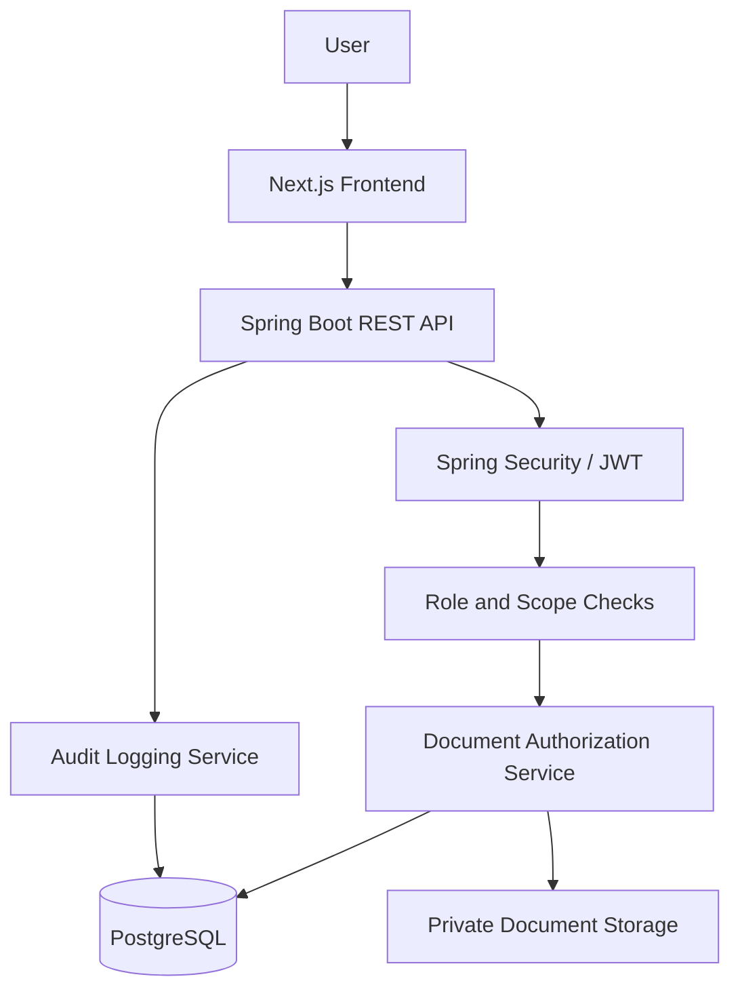
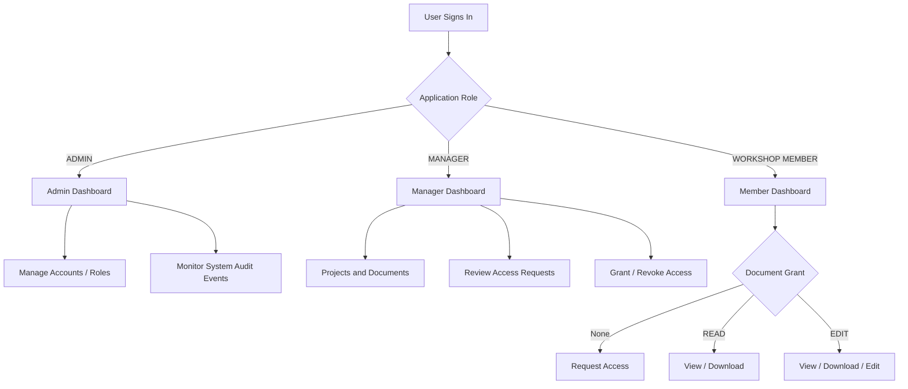
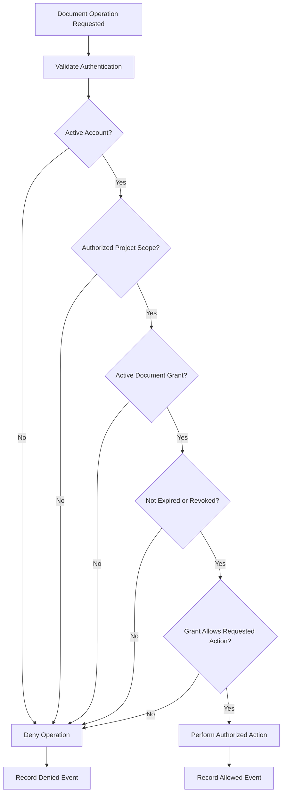
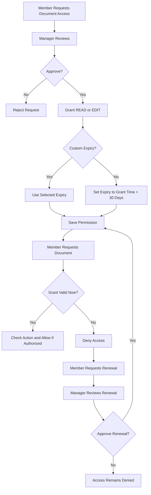
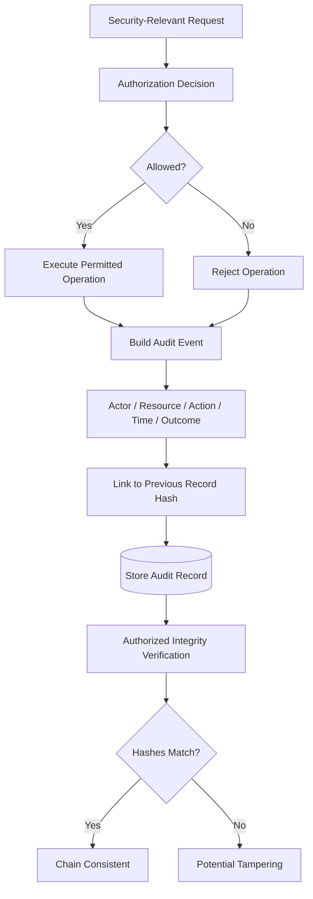

# TrustVault — Final Project Write-up

**Project:** TrustVault — Secure Document Sharing and Audit System  
**Challenge:** Snovasys Fresher Hiring Challenge 2026  
**Repository:** https://github.com/HemalathaAnnaboina/TrustVault  
**Live Application:** https://trust-vault-881v.vercel.app/  
**Backend API:** https://trustvault-7tsu.onrender.com

**Demo video:https://youtu.be/yRVHwzR3nKA

> **Evidence note:** This write-up describes the documented architecture and intended security controls. Where implementation details or successful tests have not been independently verified, they are identified as requiring verification. Diagrams describe expected flows, not proof of deployed behavior.

## 1. Executive Summary

TrustVault is a security-focused document management platform addressing two major risks: unauthorized access to confidential documents and insufficient accountability for document activity. Instead of treating project membership as blanket permission, TrustVault uses explicit document-level grants and backend authorization checks. It also records security-relevant actions to support investigation and accountability.

The system distinguishes three application roles—**ADMIN**, **MANAGER**, and **WORKSHOP MEMBER**—from document permissions (**READ** and **EDIT**). Its documented workflows include access requests, permission revocation, expiry and renewal, project isolation, and audit logging.

## 2. Problem Statement and Security Objectives

The project was organized around two objectives:

1. **Prevent unauthorized access:** Users must not read, download, edit, delete, or change permissions on documents without authorization, including through guessed IDs or direct API calls. Expired, revoked, or suspended access must not remain effective.
2. **Maintain accountability:** Record meaningful allowed and denied security events, including document activity, permission changes, and attempted unauthorized access.

These objectives make TrustVault a security engineering project rather than simply a CRUD application.

## 3. Technology Stack and System Architecture

| Layer | Technology | Responsibility |
|---|---|---|
| Frontend | Next.js, React, TypeScript | Role-specific dashboards and document workflows |
| Backend | Java, Spring Boot | REST APIs, business rules, authorization |
| Authentication | Spring Security and JWT | Identity verification and protected endpoints |
| Database | PostgreSQL (deployed configuration) | Users, projects, permissions, metadata, audit records |
| File storage | Private document storage | Document payloads; deployed persistence requires verification |
| Hosting | Vercel and Render | Frontend and backend deployment |
| Version control | GitHub | Code, evidence, documentation |

### Workflow 1 — High-Level Architecture

**Design decision:** Frontend visibility is not a security boundary. The backend must independently authorize protected operations even when users directly call an API.

## 4. Roles and Permission Model

| Application role | Responsibilities |
|---|---|
| **ADMIN** | Manage accounts and role assignments; monitor authorized system-wide security activity |
| **MANAGER** | Create projects, upload and manage documents, manage members and access requests within authorized scope |
| **WORKSHOP MEMBER** | Participate in assigned projects, request access, and use documents according to explicit grants |

**READ** permits authorized viewing/downloading; **EDIT** permits authorized viewing/downloading/editing. Neither permission alone authorizes granting access or managing system accounts. A member without an active grant must not receive protected document content. Administrative status should not automatically expose confidential document content.

### Workflow 2 — Role-Based Navigation and Document Permissions

**Project membership is not the same as document authorization.** No project-level password is required; access is enforced through authenticated identity, project scope, and per-document permissions.

## 5. Implementation Process

### Phase 1 — Requirements and Threat Analysis

Requirements were broken into user workflows, trust boundaries, negative security cases, and auditable events. Particular attention was paid to cross-project isolation and insecure direct object references (IDOR).

### Phase 2 — Authentication and Authorization

The Spring Boot backend was designed to authenticate users with JWT and apply role/scope restrictions to protected endpoints. Document operations require an additional document-specific authorization decision. A document ID, filename, or frontend route is never sufficient evidence of authorization.

### Phase 3 — Project and Document Workflows

Managers create projects, manage membership, upload documents, and handle document access requests. Workshop Members use only documents for which they have valid grants. File upload validation and protected storage form part of the documented design.

### Workflow 3 — Protected Document Access

The workflow illustrates the intended authorization sequence. Actual endpoint coverage and denied-event logging must be confirmed by tests.

### Phase 4 — Default 30-Day Permission Expiry

The documented permission policy uses **30 days by default** when a Manager grants access without choosing a custom expiry. The intended implementation stores an expiry timestamp and evaluates it when a protected request is made. This prevents reliance on a scheduled cleanup task alone.

For example, a grant issued on **24 October 2026 at 10:00** would expire on **23 November 2026 at 10:00** under an exact 30-day rule. After expiry, a member may request renewal, but the request itself does not restore access; Manager approval is required.

### Workflow 4 — Grant, Expiry, and Renewal

**Verification required:** Confirm the actual backend default, request-time expiry enforcement, revocation checks, and renewal approval behavior before describing this flow as fully tested.

### Phase 5 — Audit and Security Monitoring

The audit design covers permitted and denied security-relevant actions, including permission changes and protected document operations. The project documentation describes a hash-chained audit history intended to make unauthorized modification detectable.

### Workflow 5 — Audit Event and Integrity Check

A valid hash chain is **tamper-evidence**, not proof that no privileged party could rewrite both the data and chain. External anchoring and independently protected backups would strengthen guarantees.

### Phase 6 — Frontend and Deployment

Separate Admin, Manager, and Workshop Member views were built around distinct responsibilities. The frontend was deployed on Vercel and the backend on Render. Cross-origin API integration, environment configuration, role-based navigation, and error handling were important integration considerations.

## 6. Challenges, Debugging, and Engineering Decisions

| Challenge | Observed issue or risk | Engineering response / lesson |
|---|---|---|
| IDOR and cross-project isolation | Guessable IDs or broad membership could expose documents | Enforce document-level checks in backend, not just UI |
| Suspended member access | A suspended member might retain document access | Validate account and project status for every protected operation |
| Audit log exposure | Audit endpoints/navigation risked exposing security information | Restrict audit endpoints and views to authorized roles |
| Document API HTTP 400 | Document retrieval returned Bad Request during development | Inspect controller contract, parameters, and validation without weakening security |
| Duplicate React keys | Manager view reported duplicate key involving a document filename | Inspect actual IDs and list rendering; observed code used `key={doc.id}` |
| Pending count mismatch | Pending badge and visible list disagreed | Align scope/status filtering and verify count against list |
| Cloud deployment | Vercel/Render integration and free-tier cold starts | Verify real API workflows after deployment |

Screenshots of several **before-fix** issues were collected under `docs/screenshots/`. These images demonstrate the debugging process but do not independently prove fixes were successful.

## 7. AI-Assisted Development

AI was used for requirement decomposition, architecture discussion, authorization reviews, debugging, regression-test ideas, and documentation. The workflow was iterative: define the problem, specify security constraints, review suggestions, refine unsafe or incomplete approaches, implement, and test.

Examples include document authorization, expiry/renewal logic, account suspension, audit endpoint restrictions, and frontend API errors. AI suggestions were not treated as evidence of security correctness. The development journal is documented in [PROMPTS.md](PROMPTS.md).

## 8. Security Testing Strategy

The most important tests are negative tests: unauthorized operations must fail.

| Scenario | Expected result |
|---|---|
| Unauthorized user guesses a document ID | Denied |
| Project member lacks document grant | Denied |
| READ member attempts edit | Denied |
| EDIT member attempts permission management | Denied |
| Permission revoked or expired | Subsequent protected access denied |
| Suspended/deactivated account requests document | Denied |
| Member requests system audit logs | Denied |
| User attempts cross-project access | Denied |
| Disallowed file upload | Rejected |
| Unauthorized operation | Appropriate denied audit event recorded |

The actual automated test count and pass/fail results should be added from the latest Maven test run. Do not report these expectations as verified results without test evidence.

## 9. Threat Modeling

The project uses the **STRIDE** framework: spoofing, tampering, repudiation, information disclosure, denial of service, and elevation of privilege. The security design considers JWT misuse, unauthorized modification, audit tampering, IDOR, excessive requests, and permission escalation. See [THREATS.md](THREATS.md) for detailed analysis and residual risks.

## 10. Known Limitations and Incomplete Work

- **Free-tier hosting:** Render may spin down after inactivity and delay initial API requests.
- **Storage durability:** Verify whether uploaded files survive service restarts/redeployments and whether backups exist.
- **Security verification:** Documented test scenarios need recorded, passing test output.
- **Previously observed bugs:** Confirm resolution of the HTTP 400, duplicate-key warning, and pending-count mismatch.
- **Hardening opportunities:** Managed encryption at rest, external audit anchoring, durable backups, and distributed rate limiting.
- **Expiry verification:** Confirm the 30-day default and every-request expiry checks in the deployed backend.

## 11. Key Learnings

TrustVault demonstrates why authentication is not authorization, why project membership is not equivalent to document permission, and why backend enforcement and negative tests are essential. It also demonstrates that audit data itself needs protection, AI-generated suggestions require review, and a successful deployment is not the same as a security-verified system.

## 12. Conclusion

TrustVault was designed as a security-first document-sharing system, combining role-specific responsibilities with explicit, revocable, time-limited document access and accountable activity tracking. The project highlights engineering decisions, real debugging challenges, and a verification-oriented approach to security. Its central goal is that only authorized users can reach confidential documents and that security-relevant actions can be investigated.
